# Strength Lab 현재 주 생성 경로 (구현 그대로)

- 기준 브랜치: `cursor/coaching-orchestrator-fca8`, 커밋 `33e0a4c` (2026-10-12 KST에 읽음)
- v2 계약: PR #65 head (`docs/architecture-v2.md`, `src/lib/programming/v2/*`)
- 읽기만 했다. 코드, DB, 플래그는 하나도 바꾸지 않았다.
- 각 주장 뒤에 `파일:줄`을 붙였다. 경로 앞의 `src/lib/programming/`는 줄여서 `prog/`로 쓴다.
- 코치별 프롬프트 원문은 `/workspace/handoff/coach-prompts.md`에 있다. 여기서는 되풀이하지 않는다.
- 확실하지 않은 내용은 "확인 못 함"이라고 적었다.

---

## 0. 한눈에 보는 실제 흐름

```mermaid
flowchart TD
  UI["화면 /api/month-plan → ensureClassWeek"] --> ECW["ensureClassWeekForStart<br/>month-plan/class-week.ts:119"]
  ECW -->|class_weeks 행 있음| RET0["그 행 반환 (재생성 없음)"]
  ECW -->|없음| EPW["ensureProgrammingWeek<br/>engine.ts:281"]
  ADMIN["관리자 / plan-lab"] --> RPW["regenerateProgrammingWeek<br/>engine.ts:287"]
  EPW -->|활성 행 있음| RET1["활성 행 반환"]
  EPW -->|없음| WPW
  RPW --> WPW["writeProgrammingWeek<br/>engine.ts:429"]
  WPW --> EPM["ensureProgrammingMonth → authorMonth<br/>실패 시 fallbackMonth (engine.ts:231-245)<br/>COACHING_PIPELINE=1이면 결정적 coaching_plan 부착"]
  EPM --> LONG{"LONGITUDINAL_PLANNING=1?"}
  LONG -->|예| PL["planLongitudinal (스켈레톤)"]
  LONG -->|아니오| RCO
  PL --> RCO["runCoachingOrchestrator<br/>coaching/orchestrator.ts:15"]
  RCO -->|키 없음| NM["no-model 경로<br/>authorWeeklyIntent+authorWeek(key=null)<br/>→ realize 또는 legacy fallback<br/>engine.ts:504-620"]
  RCO -->|월 코치 응답이 7일 주 JSON| WD["persistWeekDocument<br/>engine.ts:298"]
  RCO -->|키 있음| CW["coachWeek → coachWeekActive<br/>pipeline.ts:112 / orchestrate.ts:972"]

  CW --> M["① 월간 코치 coachMonthly<br/>실패 → deterministicMonthlyPlan 으로 조용히 대체"]
  M --> W{"② 잠긴 스켈레톤?"}
  W -->|예| WS["planFromLockedSkeleton"]
  W -->|아니오| WC["주간 코치 (+재시도, 라우터)<br/>실패 → planCoachedWeek 결정적 계획"]
  WS --> AS
  WC --> AS["③ assembleLegalWeek 결정적 7일 바탕<br/>judge 실패 → realizeWeekFromIntent legacy"]
  AS --> SL["④ conditioning_slots<br/>goal_table 있으면 slotsFromWeekGoal<br/>없으면 placeConditioningSlots(board)"]
  SL --> DAY["⑤ 훈련일마다 writeSession<br/>strength/conditioning/warmup 3호출"]
  DAY -->|영역 실패: http_error/timeout| RT["400ms 뒤 1회 재호출"]
  DAY -->|영역 실패: 스키마| DR["day recovery 1회 (필드/셀 수정)"]
  RT --> DAYOK
  DR --> DAYOK{"하루 채택?"}
  DAYOK -->|아니오| FB["그날은 결정적 세션 유지<br/>daySources=fallback, unresolvedDays 등록"]
  DAYOK -->|예| MD["daySources=model"]
  FB --> LD
  MD --> LD["⑥ 부하 코치 (실패 → 결정적 표)"]
  LD --> PLC["⑦ placeTrainingDays 요일 교환<br/>goal_table 있으면 아무것도 안 함"]
  PLC --> RO["⑧ 최근 주 겹침 날 재작성 (1회)"]
  RO --> AN["⑨ 분석 묶음 + middle_manager 조정"]
  AN --> HJ["⑩ variation_judge / recovery_judge (조건부)"]
  HJ --> HC["⑪ Head Coach 1회 (head-coach-v8)"]
  HC --> HP["⑫ runAdjustmentPass + applyHeadCells<br/>셀 반영, 재검증 없음"]
  HP --> PHJ["⑬ post_head_judge = 진단만<br/>finalErrors 는 빈 배열로 시작"]
  PHJ --> FE{"finalErrors 원천<br/>스켈레톤 위반 / unresolved_day / BLOCK"}
  FE -->|없음| OK["week_status VALIDATED<br/>generation_source = 모든 훈련일이 model이면 model"]
  FE -->|있음| BAD["week_status FAILED<br/>final_status FINALIZE_WITH_WARNING"]
  OK --> SAVE["engine.ts:782-813 insertProgrammingWeek(status=active)<br/>→ syncClassWeek"]
  BAD --> FAILSAVE["engine.ts:645-691 recordFailedProgrammingWeek<br/>기존 활성 행 있으면 그것 반환<br/>없으면 실패 행 반환 (stage16은 legacy fallback 금지)"]
  FAILSAVE --> ECW2["ensureClassWeekForStart 가 실패 행을<br/>syncClassWeek 로 화면에 복사할 수 있음 (class-week.ts:122-126)"]
```

---

## 1. 진입점과 분기

### 1.1 화면 진입
- `ensureClassWeekForStart(weekStart)`는 `class_weeks` 행이 있으면 그대로 반환한다. 화면을 열어도 재생성하지 않는다. `month-plan/class-week.ts:119-121`
- 행이 없으면 `ensureProgrammingWeek(weekStart, { nowMs })`를 부른다. `key`를 넘기지 않는다. `class-week.ts:122`
  - `key === undefined`이면 `resolveImplicitCoachKey()`가 환경변수에서 키를 읽는다. 키가 있으면 화면 진입만으로 코칭 파이프라인이 돌 수 있다. `engine.ts:452`, `coaching/orchestrator.ts:9-16`, `coaching/provider.ts:61-69`
  - architecture-v2.md 1절은 "키 없이 호출"이라고 적었다. 인자로 키를 안 넘기는 것은 맞지만, 실제로는 env 키를 읽는다. 이 차이는 문서 쪽 오류다.
- 반환된 주 행이 `class_weeks`에 아직 없으면 `syncClassWeek(programmed)`로 복사한다. 이때 `programmed`가 실패 행(`status='failed'`)이어도 복사한다. `class-week.ts:123-126` (4절 문제 P7)

### 1.2 엔진
- `ensureProgrammingWeek`: 활성 행이 있으면 반환하고, 없으면 `writeProgrammingWeek(..., "create")`를 부른다. `engine.ts:281-285`
- `regenerateProgrammingWeek`: 항상 `"regenerate"`로 쓴다. `engine.ts:287-289`
- `writeProgrammingWeek`가 하는 일, `engine.ts:429-815`
  1. `ensureProgrammingMonth`로 월 행을 확보한다. 없으면 `authorMonth`를 부르고, 실패하면 `fallbackMonth`를 쓴다. `COACHING_PIPELINE=1`이면 `withCoachingPlan`이 결정적 `coaching_plan`(goal_table 포함, `reuse` 없음)을 붙인다. `engine.ts:225-259`, `coaching/monthly.ts:75-78`
  2. 요약, 최근 구조, 최근 리프트 맵, 최근 4주 intent를 모은다. `engine.ts:436-452`
  3. `LONGITUDINAL_PLANNING=1`이면 `planLongitudinal`이 스켈레톤을 만든다. `engine.ts:453-463`, `planning/flag.ts:2-4`
  4. 프로브 모드에서 운영 주 2026-10-05면 예외를 던진다. `engine.ts:466-468`
  5. `runCoachingOrchestrator`를 부른다. `engine.ts:469-484`
- `runCoachingOrchestrator`가 내는 결과는 셋이다. `coaching/orchestrator.ts:10-25`
  - `no-model`: 키가 문자열이 아니거나 빈 문자열이다. 이때 `coachWeek`는 불리지 않는다. 그래서 `coachWeekKeyless`(`pipeline.ts:118-391`)는 이 진입로로는 닿지 않는다. 테스트에서 직접 부를 때만 쓰인다고 보인다. 실제 호출처는 확인 못 함.
  - `week-document`: 월간 코치 원문이 7일 주 JSON이면 `WeekDocumentResponse`가 던져진다. `orchestrate.ts:995-996`, `949-970`
  - `coaching`: 그 외 모든 경우다. `coachWeek` → `coachWeekActive`. `pipeline.ts:112-116`

### 1.3 활성 주 선택과 화면 동기화
- `getProgrammingWeek`는 `programming_weeks.status='active'`인 행을 고른다. `store.ts:460-463`
- `insertProgrammingWeek` (`store.ts:494-543`)
  - `mode="create"`인데 활성 행이 이미 있으면 새 결과를 `failed`로 넣고 기존 활성 행을 돌려준다. 호출자에게는 알리지 않는다. `store.ts:522-524`
  - 그 밖에는 기존 행을 `superseded`로 바꾸고 새 행을 `active`로 넣는다. `store.ts:526-533`
  - 저장되는 상태는 `active`, `failed`, `superseded` 셋뿐이다. `week_status`(`VALIDATED`, `FAILED`)는 `intent_json` 안에만 있고 DB 상태를 정하지 않는다. `store.ts:559-589`
- `syncClassWeek`는 활성 행의 `display`를 `class_weeks`로 복사한다. 지난 날, 점수가 있는 날, 관리자가 고친 날은 덮지 않는다. `sync.ts:28-70`

### 1.4 경로를 바꾸는 플래그와 환경변수
| 이름 | 효과 | 근거 |
|---|---|---|
| `COACHING_PIPELINE=1` | 월 행에 결정적 `coaching_plan`을 붙인다. 주 생성기 선택은 바꾸지 않는다 | `coaching/models.ts:60-62`, `engine.ts:245` |
| `LONGITUDINAL_PLANNING=1` | 스켈레톤을 만들고 잠근다. 주간 코치 호출을 건너뛴다 | `planning/flag.ts:2-4`, `orchestrate.ts:1031-1053` |
| `COACH_MODEL_PROVIDER` | 공급자를 고른다. 공급자 키가 없으면 예외를 던진다 | `coaching/provider.ts:61-67` |
| `MONTH_PLAN_MODEL_KEY` (서버 키) | 공급자를 지정하지 않았을 때 쓰는 키 | `provider.ts:68`, `admin-tools.ts:128` |
| `*_MODEL`, `COACHING_MODEL`, `COACH_MODEL_NAME` | 코치별 모델 id | `coaching/models.ts:16-57` |
| `STRENGTH_LAB_PROBE=1` | 운영 주 2026-10-05 보호 | `engine.ts:466`, `pipeline.ts:113` |
| `MONTH_PLAN_WEEKLY_TIMEOUT_MS`, `MONTH_PLAN_MONTHLY_TIMEOUT_MS` | 호출 시간 제한 | `timeouts.ts:16,21` |
| `stage15/probe-safety.ts`의 `probeModeEnabled` | 프로브 안전장치. 세부는 확인 못 함 | `stage15/probe-safety.ts:13` |

코드 안에 고정된 꺼진 스위치도 있다. 둘 다 `false`로 박혀 있어서, 연결된 경로는 죽은 코드다.
- `replaceSimilarAfterHead = false`: 저장 직전 유사도 재판정 경로. `engine.ts:727`
- `callHeadSpecialistRewrite = false`: 헤드가 지목한 날을 전문 코치에게 다시 쓰게 하는 경로. `orchestrate.ts:2073`

---

## 2. `coachWeekActive` 단계별 순서

공통 사항
- 모든 모델 호출은 `askCoach`를 거친다. 검증에 실패하면 오류만 붙여 1회 재시도한다. HTTP 실패는 재시도하지 않는다. `coaching/llm.ts:146-151`
- `noteFailure`는 첫 실패 사유 하나만 기억한다. 이 값이 마지막에 `fallback_reason`이 된다. `orchestrate.ts:977-980`, `2182-2186`

### ① 월간 코치, `orchestrate.ts:984-1021`, `coaching/monthly.ts:140-279`
- 입력: `monthlyCoachPayload(month, actual)`. `monthly.ts:80-105`
- 출력: `MonthlyCoachPlan`(strength_method, block_goal, week_roles, goal_table 등). `types.ts:441-468`
- 분기
  - `coaching_plan.reuse === true`이고 goal_table이 검사를 통과하면 모델을 부르지 않고 기록된 계획을 재사용한다. `monthly.ts:155-180`
    - `src` 안에서 `reuse`를 `true`로 쓰는 코드는 찾지 못했다. plan-lab은 조회만 한다(`scripts/plan-lab.ts:229`). 그래서 운영 경로에서는 **주마다 월간 코치를 다시 부른다**고 판단한다. 기록하는 쪽은 확인 못 함.
  - 키가 없으면 결정적 계획을 쓴다. `monthly.ts:181-204`
  - 모델 검증은 `monthlyPlanErrors`, `monthlyStrategyErrors`, `goalTableErrors` 셋이다. `maxTokens` 8000. `monthly.ts:205-224`
  - 검증에 2번 실패하면(`!asked.ok`) `deterministicMonthlyPlan`을 반환한다. 트레이스에는 `source:"fallback"`이 남지만 **주 생성은 멈추지 않고 결정적 goal_table로 계속 간다.** `monthly.ts:225-251`
  - 모델 성공 시에도 goal_table을 파싱하지 못하면 결정적 goal_table로 바꾼다. `monthly.ts:134`
- 주 JSON이 돌아오면 `WeekDocumentResponse`를 던진다. `orchestrate.ts:995-996`
- `monthly_validator` 트레이스는 기록만 하고 흐름을 바꾸지 않는다. `orchestrate.ts:1003-1021`
- 월간 결정적 표(`deterministicGoalTable`) 구조, `coaching/goal-table.ts:220-277`
  - 요일마다 `pickCell`로 칸을 고른다. `goal-table.ts:199-214`
  - 칸 목록 `focusCatalog`의 정렬 순서는 focus(5) × pattern(7) × region(4) × energy(3) × stimulus(3)다. focus가 가장 바깥 루프라서 focus 하나에 252칸이 붙는다. `goal-table.ts:168-180`, `types.ts:104-118`, `types.ts:14`
  - 시작 위치 `shift = (weekIndex*11 + dayIndex*3) % 1260`의 최댓값은 4*11+6*3 = 62다. 그래서 항상 첫 focus `lower_strength` 구간(0-251) 안에서 고른다. 0-35는 `squat`, 36-71은 `hinge`다. **결과: 1-2주는 스쿼트, 3-4주는 힌지, 모든 훈련일이 `lower_strength`가 된다.** 막힌 칸은 다음 칸으로 넘어갈 뿐이라 focus가 바뀌지 않는다. `goal-table.ts:206-211`
  - 강도는 `[3,4,4,5,3,4]` 순환이고 deload는 2다. `goal-table.ts:251`
  - `purpose`는 영어 템플릿이다. `goal-table.ts:260`
- `monthConditioningBoard`(결정적 컨디셔닝 표)는 goal_table이 **없을 때만** `placeConditioningSlots`가 쓴다. 결정적 계획에도 goal_table이 늘 들어가므로 현재 키 경로에서는 사실상 안 쓰인다. `orchestrate.ts:1350-1360`, `conditioning-board.ts:56,219-235,276`

### ② 주간 계획, `orchestrate.ts:1023-1319`
- 결정적 기본값은 `planCoachedWeek`이다. `orchestrate.ts:1023-1029`
- 잠긴 스켈레톤이 있으면 `planFromLockedSkeleton`을 쓰고 주간 코치는 부르지 않는다. `orchestrate.ts:1031-1052`
- 주간 코치: `askCoach("weekly")`, `maxTokens` 6000. `orchestrate.ts:1054-1085`
  - 검증: `weeklyIntentErrors` → `parseWeeklyIntent` → `weekPlanErrors(rules)` + `weekGoalAlignmentErrors(goal)`. `orchestrate.ts:1073-1084`
  - 성공하면 `intent_source:"model"`, `weeklyFromModel=true`. `orchestrate.ts:1088-1101`
- 라우터
  - `routerPlan(errors)`가 `monthly`면 월간 코치를 한 번 더 부르고 goal_table을 갈아 끼운다. 주간 코치를 다시 부르지는 않고, 다음 조건으로 넘어간다. `orchestrate.ts:1135-1171`
  - `weekly`면 오류를 `revision_instruction`으로 붙여 주간 코치를 1회 다시 부른다. `orchestrate.ts:1172-1260`
  - 재시도 채택 조건(`1223`)에는 `weekGoalAlignmentErrors`가 없다. `validate` 안에서는 검사한다(`1212-1213`).
- 실패하면 **결정적 `planCoachedWeek`가 조용히 주 계획이 된다.** 주는 멈추지 않는다. `orchestrate.ts:1029`, `1102`
- `weekly_validator`(`weekPlanErrors`)와 `week_structure_analyzer`는 트레이스만 남긴다. `planRuleErrors`가 있어도 흐름이 그대로 간다. `orchestrate.ts:1261-1319`

### ③ 결정적 7일 바탕, `orchestrate.ts:1321-1342`
- `assembleLegalWeek`가 계획대로 7일 결정적 세션을 만든다. 모델 날은 나중에 이 위를 덮어쓴다.
- judge에 실패하면 `realizeWeekFromIntent`로 만든 legacy 주를 바탕으로 쓴다. `1329-1342`

### ④ 컨디셔닝 칸, `orchestrate.ts:1350-1360`
- goal_table 주가 있으면 `slotsFromWeekGoal`, 없으면 `placeConditioningSlots`를 쓴다.

### ⑤ 일별 세션 `writeSession`, `orchestrate.ts:474-853`, 호출 `1361-1390`
- 훈련일 순서대로 `strength`, `conditioning`, `warmup` 세 영역을 각각 `askSpecialist`로 부른다. `orchestrate.ts:532`, `603-627`
- 영역 검증: `areaShapeErrors`. conditioning은 병합 후 `adoptDay` 검사와 겹침 검사까지 받는다. `orchestrate.ts:565-602`
- 실패 시 복구는 `revisionNumber===0`일 때만 한다. `orchestrate.ts:630`
  - 일시 장애(`http_error`, `timeout`)는 400ms 뒤 같은 요청을 1회 다시 보낸다. `orchestrate.ts:634-660`, `day-recovery.ts:8,25,36`
  - 그 밖의 실패는 day recovery 1회다. 실패한 필드나 셀만 고치게 하고, `recoveryDrift`로 다른 필드가 바뀌었는지 본다. `orchestrate.ts:661-735`, `day-recovery.ts:5`(`MAX_DAY_SCHEMA_RECOVERIES = 1`), `167-222`
- `adoptDay`, `orchestrate.ts:314-374`
  - `sessionSelfErrors`, 스켈레톤 필드 오류, 칸 적합 오류(`slotFitErrors`)를 본다.
  - **goal_table 칸(`goalOwned`)이면 잠긴 스켈레톤 필드 검사를 건너뛴다.** `orchestrate.ts:329-335`
  - `slotFitErrors`는 `from_goal`이 아니고 `primary_keys`도 없으면 "is banned" 오류만 본다. `orchestrate.ts:336-340`
- 하루에 실패하면 그날은 ③의 결정적 세션이 남는다. `daySources=fallback`이 되고, 비일시 실패면 `unresolvedDays`에 들어간다. `orchestrate.ts:736-772`, `1386-1389`
- 쉬는 날은 `session_coach` 트레이스만 남긴다. `orchestrate.ts:1391-1414`

### ⑥ 부하 코치, `orchestrate.ts:1416-1508`
- 입력: 방법, 주차, 단계, 보고된 피로, 결정일. 출력: `LoadDecision[]`. `maxTokens` 1600.
- 실패하면 `deterministicLoadDecisions`. 성공하면 `applyLoadDecisions`로 반영한다. `1454-1461`
- `load_validator`는 judge 오류 중 "sets do not match"만 걸러 기록하고 흐름은 바꾸지 않는다. `1487-1508`

### ⑦ 요일 배치 `placeTrainingDays`, `orchestrate.ts:1525-1557`, `coaching/day-place.ts:75-`
- 세션을 다른 훈련일로 바꿔 끼우는 순열을 찾는다. 순서 위반과 유사도 위반이 가장 적은 배치를 고른다. `day-place.ts:63-67`, `106-`
- **`lockWeekdays = goal_table 주가 있음`이면 즉시 그대로 반환한다.** 지금은 결정적 계획에도 goal_table이 있으므로, 요일 교환으로 겹침을 줄이는 기능은 사실상 꺼져 있다. `orchestrate.ts:1530`, `day-place.ts:83`
- 교환이 일어나면 `daySources`, unresolved 등을 원래 날 기준으로 옮긴다. `input.longitudinal.skeleton`도 **입력 객체를 직접 바꾼다.** `orchestrate.ts:1546-1557`

### ⑧ 최근 주 겹침 재작성, `orchestrate.ts:1558-1621`
- 대상은 `recentOverlapDays`(임계 4 이상)와 `movement_combo`가 맞은 날이다. 날마다 `writeSession(revisionNumber:1)`을 1회 부른다. 이 호출은 `revisionNumber`가 1이라 ⑤의 복구를 타지 않는다.
- 여전히 겹치면 `still_overlapping`만 기록하고 넘어간다. 막지 않는다.

### ⑨ 분석과 중간 조정, `orchestrate.ts:1510-1523`, `1623-1654`
- `analyzeBundle`: 피로, 변이, stage13 전문 검토, integrator.
- `runAdjustmentPass`(middle_manager)는 전문 코치 제안을 필드 단위로 반영한다. `stage16/pass.ts:35-`

### ⑩ 심판, `orchestrate.ts:1671-1776`
- `variation_judge`는 `variationNeedsJudge`일 때만 부른다. concern이 없으면 변이 지적을 지운다.
- `recovery_judge`는 `recoveryNeedsJudge`일 때만 부르고, 결과는 기록만 한다. 둘 다 `maxTokens` 400.

### ⑪ Head Coach, `orchestrate.ts:1666-1977`
- 프롬프트 `head-coach-v8`(`prompts.ts:11`), `maxTokens` 1800, 1회 호출(+검증 재시도 1회).
- 입력에 들어가는 것: `hard_rule_findings`, `pre_head_judge`, 배치 위반, 유사도 hits(threshold), 겹침 재작성 결과, `piece_cells`, unresolved, 월 목표, 규칙, 피로, 전문 소견, 코드 판단 5단계. `1819-1858`
- `evaluateHead`가 코드 판단(evidence, risk, priority, tradeoff, action)을 먼저 낸다. `mergeHeadWithCode`가 모델 판단과 합친다. `1777-1818`, `1912`, `stage14/merge.ts:39`
- `rejectedRevisionSpecs`로 범위 밖 수정을 걸러 `revision_rejected` 트레이스를 남긴다. `1886-1916`, `day-recovery.ts:123`
- `applyHeadPolicy`로 integrator와 맞춘다. `1921`, `stage13/revision.ts:62`
- `headDecision`을 만들 때 BLOCK은 `APPROVE_WITH_NOTE`로 바뀐다. 채택은 뒤에서 `headModelStatus`로 따로 막는다. `1937`, `2351-2376`

### ⑫ 헤드 수정 반영, `orchestrate.ts:1978-2060`
- 모델이 REVISE이고 조정이 있으면 `runAdjustmentPass`(stance `ACCEPT`, `ADJUST` 등)를 돈다. ADJUST인데 실제로 반영된 것이 없으면 `ACCEPT_WITH_NOTE`로 낮춘다. `stage16/pass.ts:50-59`
- 그 뒤 `review.status`를 stance만 보고 `APPROVE` 또는 `APPROVE_WITH_NOTE`로 **덮어쓴다.** `orchestrate.ts:2006-2010`
- `applyHeadCells`는 `catalog_key`와 `field` 셀을 코드가 바로 쓴다. 조각에 없는 키나 패치 실패는 `reverted`로 기록한다. `orchestrate.ts:2011-2060`, `head-cells.ts:49-91`
- 셀을 쓴 뒤 재검증해서 채택을 막는 단계가 없다(⑬ 참고).

### ⑬ 최종 판정, `orchestrate.ts:2173-2507`
- `finalStatus`: stance가 ADJUST면 `ADJUST`, ACCEPT면 `APPROVE`, 그 외는 `APPROVE_WITH_NOTE`. `2173`
- `accepted`: (주간 모델이거나 잠긴 스켈레톤) **그리고** 모든 훈련일이 model **그리고** finalStatus가 APPROVE, APPROVE_WITH_NOTE, **ADJUST** 중 하나. 이 값은 `fallbackReason`만 정한다. `2178-2186`
- `modelAdopted`는 `prescriptionSource`에서 온다. 모든 훈련일이 model이면 `model`이다. **주간 코치 실패나 헤드 상태는 보지 않는다.** `2176-2177`, `stage13/policy.ts:40-52`
- `finalWeekReport`는 judgeWeek, 단위, 주 계획 규칙, 수업 시간, 긴 컨디셔닝을 본다(`stage13/validators.ts:137-`). 그런데 이 결과는 **`post_head_judge` 진단 트레이스로만 남는다.** `orchestrate.ts:2209-2237`
- `let finalErrors: string[] = []`이라 `2246`의 하드 오류 날 교체 블록(isolationPlan → replaceDays)은 **실행되지 않는다.** `orchestrate.ts:2238-2300`
- 실제로 `finalErrors`를 채우는 원천은 셋뿐이다.
  1. 잠긴 스켈레톤 위반. 단, goal_table 날은 걸러서 뺀다. `2301-2340`
  2. `unresolvedDays`. `2341-2350`
  3. 헤드 BLOCK. `2351-2376`
- 최종 오류가 있는데 승인 상태면 `approval_refused`가 되고 FINALIZE_WITH_WARNING으로 바꾼다. 여기서 ADJUST는 조건에 없지만, `2404`에서 `modelAdopted=false`가 된다. `2377-2404`
- 날 기록: `final_source`는 FAILED, DETERMINISTIC_ADJUSTMENT, HEAD_ADJUSTED, MODEL_ADJUSTED, MODEL_REVISED, MODEL, FALLBACK 중 하나다. `day_status`는 FAILED, HEAD_ADJUSTED, MODEL_ADJUSTED, MODEL_REVISED, MODEL, FALLBACK 중 하나다. `2405-2460`
- `week_status`: 오류나 실패 날이 있으면 `FAILED`, 아니면 `VALIDATED`다. `ACTIVE`와 `DRAFT`는 쓰지 않는다. `2461-2462`, `stage15/isolate.ts:32-35`
- 반환값: `generation_source = modelAdopted ? model : fallback`, `pipeline:"stage16"`, `final_validation{ok, errors…}`. `2508-2541`

### ⑭ 저장, `engine.ts:621-814`
- `rejected_draft`가 있으면 실패 행으로 기록한다. 그런데 `rejectedDraft`는 `2239`에서 null로 시작하고 다시 채워지는 곳을 찾지 못했다. 사실상 쓰이지 않는다고 판단하지만 확인 못 함. `engine.ts:623-644`
- `final_validation.ok === false`일 때 (`engine.ts:645-721`)
  - 실패 행을 기록한다(`generation_source`와 `fallback_reason`에 `;final_validation_failed`를 붙임).
  - 기존 활성 행이 있으면 그 행을 반환한다. `670-671`
  - `coachingWeekMayUseLegacyFallback`은 `pipeline==="stage16"`이면 항상 false다. 그래서 legacy fallback 주로 대체하지 않고 실패 행을 반환한다. `680-690`, `stage16/hard.ts:92-101`
- 성공하면 `insertProgrammingWeek(generationSource=coached.generation_source)`, `insertCoachTraces`, `syncClassWeek`. 월 목표가 바뀌었으면 예외를 던진다. `engine.ts:782-813`
- no-model 경로: `authorWeek`가 성공하면 `model`, 아니면 `realizeWeekFromIntent`나 legacy fallback이다. `generationWrite`가 `ok`에 따라 model 또는 fallback을 정한다. `engine.ts:504-620`, `200-221`

---

## 3. 데이터 계약

### 3.1 주요 타입 (`prog/types.ts`)
- `DaySessionGoal`(day, rest, purpose, focus, intensity, target, stimulus, time_domain). `types.ts:129-138`
- `SessionFocus`: `lower_strength`, `upper_strength`, `gymnastics_skill`, `engine_endurance`, `weightlifting_cycling`. `types.ts:104-110`
- `SessionDraft` `182-`, `DayIntent` `276-`, `WeeklyIntentPlan` `298-`, `WeekDraft{intent, sessions}` `398-401`, `MonthDirection` `403-`, `MonthlyCoachPlan` `441-468`, `StoredStructure` `549-`
- `CanonicalDaySource`: MODEL, MODEL_REVISED, MODEL_ADJUSTED, HEAD_ADJUSTED, DETERMINISTIC_ADJUSTMENT, DETERMINISTIC_FALLBACK, LEGACY_FALLBACK, FALLBACK, FAILED. `368-377`
- `DayLifecycle`. `379`
- `WeekLifecycle`: DRAFT, VALIDATED, ACTIVE, FAILED. `381`
- `DayPrescriptionRecord`. `384-396`
- `GenerationSource`: `model`, `fallback`. `470`
- `FallbackReason`: no_model, timeout, http_error, bad_json, truncated, schema, invented_weight, language, rule_break, feedback, weekday_pattern, too_similar. `472-484`
  - 실제로 쓰는 값은 이 합집합 밖의 문자열이 더 많다. `final_validation_failed`, `unresolved_day`, `head_block`, `skeleton_lock`, `fallback_after_model_failure:n/m`, 이들을 `;`로 이은 값이다. `orchestrate.ts:2185,2298,2333,2348,2354`, `engine.ts:655-659`
- 유사도: `SIMILARITY_CONFIG.threshold = 4`. 가중치는 format, time_domain, stimulus, movement_pattern, equipment, volume이 각 1, `movement_combo` 4, 나머지 0이다. `types.ts:529-547`, 사용처 `rules.ts:1029-1111`

### 3.2 `CoachWeekResult` (`coaching/pipeline.ts:47-80`)
- `generation_source: model|fallback`
- `final_status: APPROVE|APPROVE_WITH_NOTE|ADJUST|FINALIZE_WITH_WARNING`
- `final_validation{ok, errors: string[], …}`, `day_sources`, `day_records`, `week_status`, `prescription_source`, `pipeline`

### 3.3 헤드 관련 상태
- `HeadCoachReview.status`: APPROVE, APPROVE_WITH_NOTE, REVISE, BLOCK. `coaching/review.ts`, architecture-v2.md 2절
- stage16 stance: ACCEPT, ADJUST, ACCEPT_WITH_NOTE, FLAG 등. `stage16/pass.ts:11,44-68`
- `PrescriptionSource`: model, model_revised, fallback, fallback_after_model_failure, legacy. `stage13/policy.ts:38-52`

### 3.4 카탈로그 `data/movement-catalog.json`
- 최상위 키: version, generated, note, sources, movements. 지금 동작은 **159개**다. 대화에서 말한 138개와 다르다.
- 동작 필드: key, proposed_key, existing, name_ko, name_en, category, pattern, equipment, units(예 `["reps"]`), ranges(예 `{"reps":"1–31"}`, 단위별 문자열 범위), rx(`{female, male}` 문자열), scale_to, sources, memo
- 로더와 프롬프트 줄은 `coaching/movement-catalog.ts`(`catalogLine`, `catalogMovement`, `movementsForSlice`, `patchStoredMovement`)에 있다. ranges 문자열 파싱 규칙의 세부는 확인 못 함.

### 3.5 오류 표현
- 검증 결과는 거의 모두 `string[]`다. 예: `judgeWeek` → `Judge.errors` (`rules.ts:2318-2358`), `finalWeekReport.hard`, `weekPlanErrors`, `goalTableErrors`(`goal-table.ts:353-410`)
- 코드는 문장 정규식으로 다시 매긴다(`classifyProgramError`). 예: `/unit|sec\b|reps|cal\b/` → UNIT_INVALID, `/benchmark/` → BENCHMARK_INVALID. `stage15/hard-rules.ts:37-70`
- 날짜는 문장 안 요일 단어로 뽑는다(`daysInText`). `hard-rules.ts:27-35`, `orchestrate.ts:2324`

---

## 4. 알려진 문제 (코드 근거)

| # | 문제 | 근거 | 영향 |
|---|---|---|---|
| P1 | 월간 코치 표가 2번 실패하면 결정적 표로 **조용히** 대체하고 계속 간다 | `monthly.ts:225-251`, `134` | 월간 방향이 반영되지 않은 채 VALIDATED까지 간다 |
| P2 | 결정적 표가 전부 `lower_strength`다. focus가 바깥 루프이고 shift ≤ 62 < 252라서다 | `goal-table.ts:168-180,206` | 1-2주 스쿼트, 3-4주 힌지만 나온다 |
| P3 | goal_table이 늘 있어서 `lockWeekdays=true`가 되고, 요일 교환 겹침 해소가 꺼진다 | `orchestrate.ts:1530`, `day-place.ts:83` | 겹침 줄이기 1차 수단이 동작하지 않는다 |
| P4 | 주간 코치가 실패해도 결정적 계획으로 진행한다. 그런데 모든 날이 model이면 `generation_source="model"`이 된다 | `orchestrate.ts:1102,2176-2177`, 테스트 `coaching-active.test.ts:455-466` | "모델 주"의 뜻이 흐려진다 |
| P5 | ADJUST가 채택 조건에 들어 있다. 헤드 상태와 상관없이 모든 날이 model이면 model로 기록된다 | `orchestrate.ts:2173,2178-2181`; `review` 덮어쓰기 `2006-2010` | 수정 요청 상태가 승인처럼 기록된다 |
| P6 | 최종 검증이 **진단 전용**이다. `finalErrors=[]`로 시작해서 하드 오류 교체 블록이 죽어 있다 | `orchestrate.ts:2209-2238,2246` | 헤드 셀 반영 후 규칙 위반이 있어도 VALIDATED로 저장된다 |
| P7 | 실패 행이 화면에 복사될 수 있다 | `engine.ts:687-689` → `class-week.ts:122-126` | 실패한 주가 수업 화면에 나타날 수 있다 |
| P8 | `create` 모드에서 활성 행이 있으면 새 결과를 failed로 넣고 기존 행을 조용히 돌려준다 | `store.ts:522-524` | 재생성이 됐다고 착각할 수 있다 |
| P9 | `week_status`가 DB 상태와 따로 논다. `VALIDATED`만 쓰고 `ACTIVE`와 `DRAFT`는 쓰지 않는다 | `isolate.ts:32-35`, `store.ts:533` | 상태가 이중으로 기록된다 |
| P10 | 뼈대가 세션 단계에서 덮인다. ① goal 칸이면 스켈레톤 필드 검사를 건너뛴다 ② goal 날의 스켈레톤 위반은 최종 오류에서 뺀다 ③ 요일 교환이 입력 스켈레톤을 직접 바꾼다 ④ 주간 검증 실패는 기록만 한다 | `orchestrate.ts:329-335`, `2306,2322-2326`, `1546`, `1261-1319` | 잠긴 계획이 바뀌어도 실패가 되지 않는다 |
| P11 | 검증 오류가 문자열이고, 문장 정규식으로 코드와 날짜를 붙인다 | `hard-rules.ts:27-70`, `day-recovery.ts:87` (`fieldEditFromError`) | 문구를 바꾸면 분류와 복구가 깨진다 |
| P12 | 같은 규칙이 여러 곳에 있다. judgeWeek가 엔진 no-model(`engine.ts:545`), week-document(`engine.ts:353`), pipeline keyless(`pipeline.ts:197,323`), orchestrate(`1338,1487,1821`), finalWeekReport(`validators.ts:149`)에서 각자 불리고 결과 해석이 다르다. 유사도는 `day-place`, `recentOverlapDays`, `similarityDiagnostics`, `engine.ts:727`(꺼짐)에 흩어져 있다. 주간 검증 블록은 `1073-1084`와 `1206-1217`에 복붙돼 있다 | 표시한 줄 | 기준이 하나가 아니다 |
| P13 | judgeWeek에 아직 `language`(한글) 단계가 남아 있다. "한글 비율 검사 없음" 방침과 맞는지 확인이 필요하다 | `rules.ts:2352` | 모델 영어 출력이 오류로 잡힐 수 있다. 실제 영향은 확인 못 함 |
| P14 | `FallbackReason` 타입 밖의 문자열 사유를 쓴다 | 3.1절 | 타입이 사유를 보장하지 못한다 |
| P15 | `coaching_plan.reuse`를 true로 쓰는 곳이 없다. 주마다 월간 코치를 다시 부른다 | `monthly.ts:155`, `rg` 결과 | 주마다 다른 월 표가 나올 수 있고 토큰이 든다 |
| P16 | 문서와 코드 버전이 다르다. `docs/codebase.md:48,49,70`은 monthly-coach-v2, weekly-coach-v2, conditioning-coach-v5로 적었지만 코드는 v4, v4, v6이다(`prompts.ts:4-8`). `docs/coaching-pipeline.md:80`은 `monthly-coach-v1`(타입 version 값)로 적었다 | 표시한 줄 | 문서를 믿고 고치면 틀린다 |
| P17 | 카탈로그 수가 159개다. 대화와 문서 기준은 138개였다 | `data/movement-catalog.json` | 집계 문서를 다시 맞춰야 한다 |
| P18 | 테스트가 현재 동작을 정답으로 고정한다. `coaching-active.test.ts:455-466`(주간 실패인데 model 기대), `:487-490`(ADJUST 기대), `:689`(4주 중 3주차 ADJUST 기대), `:400`(APPROVE + model). architecture-v2.md 1절은 `programming-stage14`와 `programming-stage16` 테스트도 현재 채택·조정 상태를 검사한다고 적었다 | 표시한 줄 | 새 계약을 붙이면 이 기대값들이 충돌한다 |
| P19 | `coachWeekKeyless`는 오케스트레이터로는 닿지 않는다. 키가 없으면 그 전에 `no-model`로 빠진다 | `orchestrator.ts:17`, `pipeline.ts:114-115` | 죽은 경로가 유지 비용만 든다 |
| P20 | 꺼진 스위치 경로 두 개(`replaceSimilarAfterHead`, `callHeadSpecialistRewrite`)가 남아 있다 | `engine.ts:727`, `orchestrate.ts:2073` | 읽는 사람이 오해한다 |

---

## 5. v2 계약(PR #65)과 현재 구현 대응표

v2 파일: `v2/domain.ts`(타입), `v2/transition.ts`(상태 전이), `v2/issues.ts`(오류와 복구 매핑), `v2/repair.ts`(`assessRepairs`), `v2/adoption.ts`(`classifyWeekOrigin`, `decideModelAdoption`, `judgeFallback`, `judgeNoModel`)

| v2 개념 | 현재 코드 | 연결할 때 바꿀 곳 |
|---|---|---|
| `GenerationStatus` draft→validated→needs_repair→approved/rejected (`transition.ts` NEXT) | `WeekLifecycle` VALIDATED/FAILED만 씀 (`isolate.ts:32`) + DB `active/failed/superseded` (`store.ts`) | `weekStatusFor` 대신 `transitionGenerationStatus`를 쓴다. 저장 상태는 `PersistenceStatus`로 따로 둔다 |
| `GenerationOrigin` model/fallback/no_model, `classifyWeekOrigin` | `GenerationSource` model/fallback + `no_model`은 사유 (`types.ts:470-484`). `prescriptionSource` (`policy.ts:40`) | `orchestrate.ts:2176-2177,2515`와 `engine.ts:200-221` `generationWrite`에서 출처를 `classifyWeekOrigin`으로 정한다. `modelCalled`에 주간 코치 성공 여부를 넣을지 정해야 한다(P4) |
| `ValidationIssue` (scope union, code, severity) | `string[]` + `classifyProgramError` 정규식 (`hard-rules.ts:37`) | Phase 2: `judgeWeek`, `finalWeekReport`, `goalTableErrors`, `weekPlanErrors`, `slotFitErrors`가 구조화된 오류를 반환하게 한다 |
| `RepairRequest` kinds | day recovery 필드 수정(`day-recovery.ts:87,167`), 헤드 셀(`head-cells.ts:49`), `replaceDays`(죽은 블록 `orchestrate.ts:2253`), 겹침 재작성(`1574`), 라우터(`1135-1260`) | 각 경로를 field_edit, movement_replacement, session_regeneration, skeleton_change_request에 매핑하고 `repairRequestFitsIssue`로 막는다 |
| `RepairResult` (applied, changedFields, unexpectedFields, revalidation) | `recoveryDrift` (`day-recovery.ts:167`), `HeadCellReport.applied/reverted` (`head-cells.ts:16-91`). 재검증 결과는 없음 | 셀 반영 뒤 `finalWeekReport`를 다시 돌려 `revalidation`을 채운다(P6) |
| `HeadDecision` approve/approve_with_note/adjust/block | `HeadCoachReview.status` + stance + `finalStatus` 셋이 섞임 (`orchestrate.ts:1937,2006,2173`) | 하나로 줄이고 `adjust`는 채택 후보에서 뺀다(`2181`) |
| `decideModelAdoption` 8조건 | `accepted`(`2178`), `modelAdopted`(`2177,2294,2339,2349,2355,2382,2404`)가 여러 번 덮어씀 | 함수 끝에서 한 번 `decideModelAdoption`을 부르고 그 결과로 `generation_source`와 `week_status`를 정한다 |
| `lockedSkeletonHeld` | `enforceLockedSkeleton` + goal 날 제외 (`2301-2340`) | goal 날 제외를 없애거나, goal 표 자체를 잠긴 뼈대로 정의한다(P10) |
| `weekStructureValid` | `weekPlanErrors`가 트레이스만 남김 (`1261-1300`) | hard 이슈로 넘긴다 |
| `requiredDaysValid` | `unresolvedDays`, `failedDays` (`2341-2350`) | 그대로 대응한다 |
| `judgeFallback` (fallback은 adopted=false) | 결정적 날을 섞어 저장하고, 실패 시 legacy fallback 금지 (`hard.ts:92`) | 구조가 맞는 fallback 주를 활성으로 쓸지는 사용자 결정이 남아 있다(v2 문서 미정) |
| `persistApproved` | `insertProgrammingWeek`는 무조건 active (`store.ts:533`) | approved만 active로 넣고, 그 외는 failed나 draft로 넣는다. `class-week.ts:123-126`의 실패 행 동기화도 막는다(P7) |
| `WARNING_POLICY` (경고는 채택을 막지 않음) | `isCoachingSignal`로 신호와 하드를 나눔 (`validators.ts:151-152`) | 신호를 warning 이슈로 바꾼다 |

---

## 6. 다음에 손댈 순서 제안 (참고)
1. 결정적 goal_table을 손보거나, 월간 실패를 명시적 실패로 바꾼다(P1, P2).
2. `finalErrors`에 `finalWeekReport.hard`를 다시 연결하고, 헤드 셀 뒤에 재검증을 넣는다(P6).
3. 채택 판정을 `decideModelAdoption` 한 곳으로 모으고, ADJUST를 채택에서 뺀다(P4, P5). 테스트 P18을 함께 갱신한다.
4. 실패 행이 화면에 가지 않게 막는다(P7, P8).
